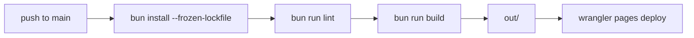

# Architecture

Single-page static portfolio, exported by Next.js and served from Cloudflare Pages.

## Tech Stack

| Layer     | Technology                                |
| --------- | ----------------------------------------- |
| Framework | Next.js 16 (App Router, `output: export`) |
| UI        | React 19                                  |
| Styling   | Tailwind CSS v4 (`@theme` in globals.css) |
| Font      | Geist Mono via `next/font/google`         |
| Tooling   | Bun, ESLint, Prettier, TypeScript         |
| Hosting   | Cloudflare Pages                          |
| Analytics | Google Analytics (gtag, lazy-loaded)      |

## Directory Structure

```
src/
├── app/
│   ├── layout.tsx          # Metadata, theme first-paint script, analytics, skip link
│   ├── page.tsx            # Home: Person JSON-LD + section composition
│   ├── not-found.tsx       # 404 page
│   ├── opengraph-image.tsx # Static OG image
│   ├── sitemap.ts / robots.ts
│   └── globals.css         # Design tokens, base styles, animations
├── components/
│   ├── SiteHeader.tsx      # Avatar, name, location, ThemeToggle
│   ├── ThemeToggle.tsx     # Client: dark/light switch
│   ├── WorkList.tsx        # Client: project list with "show more"
│   ├── MediaList.tsx       # Articles and talks
│   ├── ActivityGraph.tsx   # GitHub contribution chart (ghchart.rshah.org)
│   ├── SocialLinks.tsx     # Footer links
│   └── SectionHeading.tsx  # "# HEADING" section label
└── data/
    ├── work.ts             # WORK list
    └── media.ts            # MEDIA list
public/
├── _headers                # Cloudflare security headers
├── _redirects              # 301s for the retired /work/* routes
├── llms.txt, llms-full.txt # LLM-readable site summary
└── avatar, favicons, manifest, IndexNow key
```

## Build and Deploy



PRs run lint, `format:check` and build (`.github/workflows/pr-checks.yml`).

## Key Decisions

| Decision                | Rationale                                                                |
| ----------------------- | ------------------------------------------------------------------------ |
| Static export           | No dynamic content; CDN-served HTML is fast and free of runtime failures |
| `_redirects`/`_headers` | `next.config` redirects and headers are ignored under `output: export`   |
| Dark-first theme        | `data-theme='light'` override, set before paint by an inline script      |
| Server components first | Only `ThemeToggle` and `WorkList` need client state                      |
| Unoptimized images      | Static export has no image optimization server                           |
